# LMS — Interactive Demo

**Live demo: https://vagelistemp.github.io/lms-demo/**
Pick a role on the first screen. No account, no installation; it runs in your browser.

  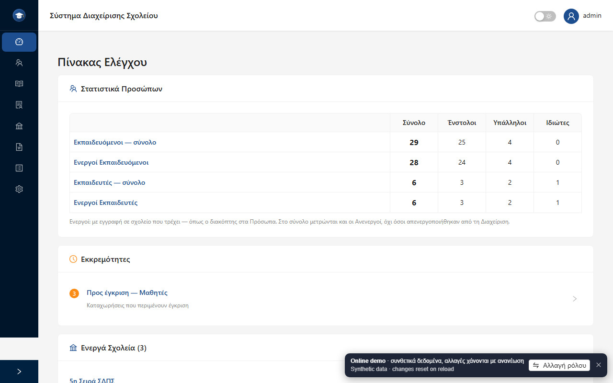

LMS is a school-management system I built for a Greek training institution. It replaces an Excel-based workflow with one
place for **people and their service history**, the **directives (official orders)** that create schools, enrol students and
assign teachers, and the **grades and absences** that decide who passes. The interface is in Greek.

## What you can try

| Role | What it shows |
|---|---|
| **Administrator** | Dashboard, people (search, filters, service history, education), directives, schools with grades / absences / statistics, **Word documents generated from templates with tokens**, reference data (ranks, units, grading scales, courses), approvals queue |
| **Teacher** | Own courses and students, grade and absence submission (which then wait for approval) |
| **Student** | Own grades, absences and the results of completed schools |
| **Registration form** | The student registration form; what it collects waits in the administrator's approvals queue |

Direct links: [administrator](https://vagelistemp.github.io/lms-demo/?role=admin#/dashboard) ·
[teacher](https://vagelistemp.github.io/lms-demo/?role=teacher#/teacher) ·
[student](https://vagelistemp.github.io/lms-demo/?role=student#/student) ·
[document generation](https://vagelistemp.github.io/lms-demo/?role=admin#/schools/1?tab=diplomas)

Things worth a look:

- **A school is created by an order, not by hand.** A *template* directive carries the course list; enrolment, teacher
  assignment, drop-out, cancellation and swap directives then change who is in the school, and can be undone with a preview.
- **Documents are Word templates with tokens.** Open a school, then *Έγγραφα*: pick one of three prototype templates (a certificate,
  a performance report with a per-course grade table, an attendance statement) and a student. Tokens such as `{{ΟΝΟΜΑ}}` or
  `{{ΤΕΛΙΚΟΣ_ΒΑΘΜΟΣ}}` are replaced with that student's data, and a table row marked `{{ΠΙΝΑΚΑΣ_ΜΑΘΗΜΑΤΩΝ}}` is repeated once
  per course. You get a live preview, a token check (recognised / unknown / image, with the value each token takes), a preview
  of the raw template with its tokens visible, and a `.docx` download. You can also upload your own `.docx` containing tokens; it is read and filled in your browser and never uploaded.
- **Status is derived, not stored.** Whether an enrollment is pending, active, completed or failed is computed from the dates,
  the grades and the absence cap.
- **Service history is dated.** A person's rank and unit change over time; every enrollment keeps a snapshot, so a finished school
  never changes retroactively.
- **Everything is editable in the demo**: add a person, enter a grade, approve a teacher's submission. Changes live in the
  page and disappear on reload.

## How this demo works

The real application has a Spring Boot backend and a MySQL database. A static site cannot run those, so this build contains
**only the front end**, together with a small in-browser backend that answers the same API calls. Its answers were recorded from
the real backend running on a **synthetic data set** (invented people, units and schools; nothing from real life), and edits are
applied to an in-memory copy. Nothing is sent anywhere.

The Word documents are generated in the browser from three neutral prototype templates, with the same token syntax the real
application uses (the demo understands a subset of its token vocabulary). The remaining features that work with files on the
server (Excel exports, the template library, movement orders, the registry, backups) appear in the menu but are disabled here,
with a short note.

## The real application

- **Backend:** Java 21, Spring Boot 3, Spring Security (JWT in httpOnly cookies, refresh-token revocation, login
  throttling), Spring Data JPA, Flyway (76 migrations), MySQL 8, an AOP audit trail
- **Frontend:** React 18, Vite, Ant Design 5, TanStack Query, Zustand, React Router
- **Delivery:** Docker images for the VM, with a script that builds and verifies them

This repository contains only the built demo. The application's source code is private.

## Screenshots

  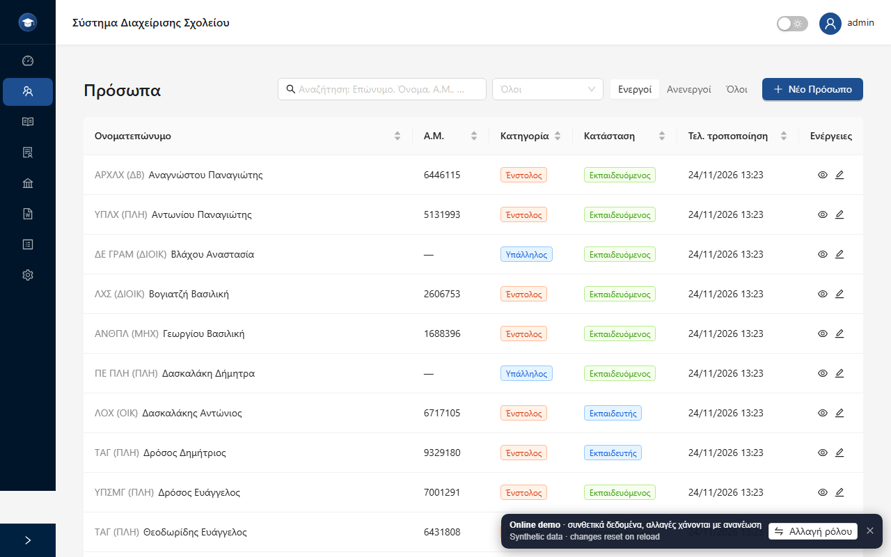
  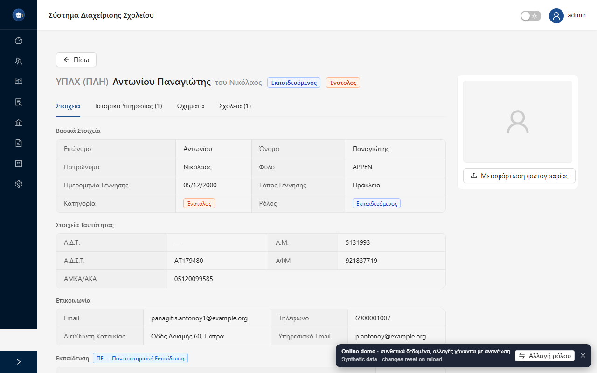

  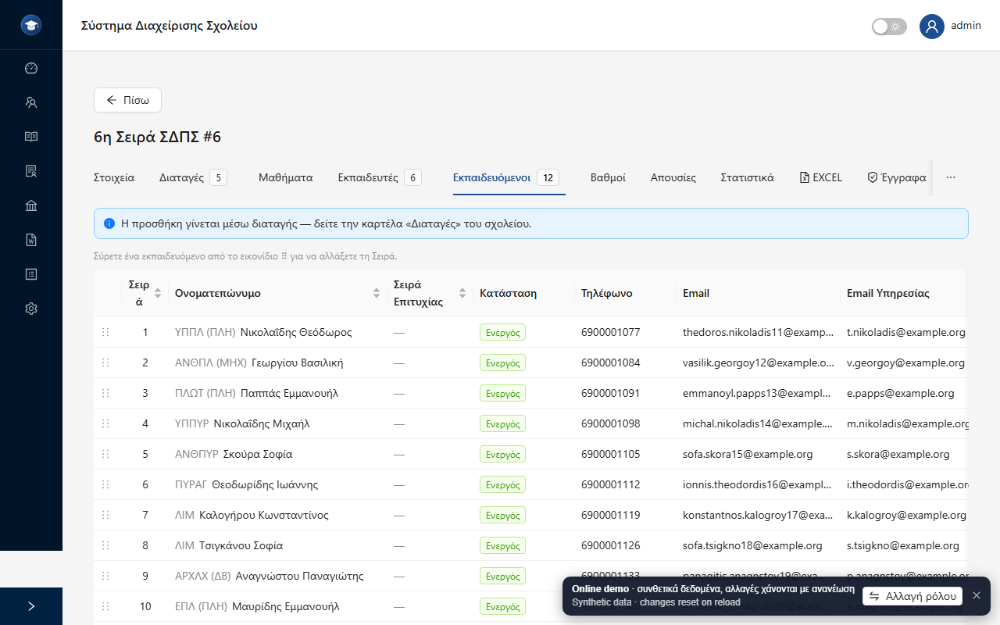
  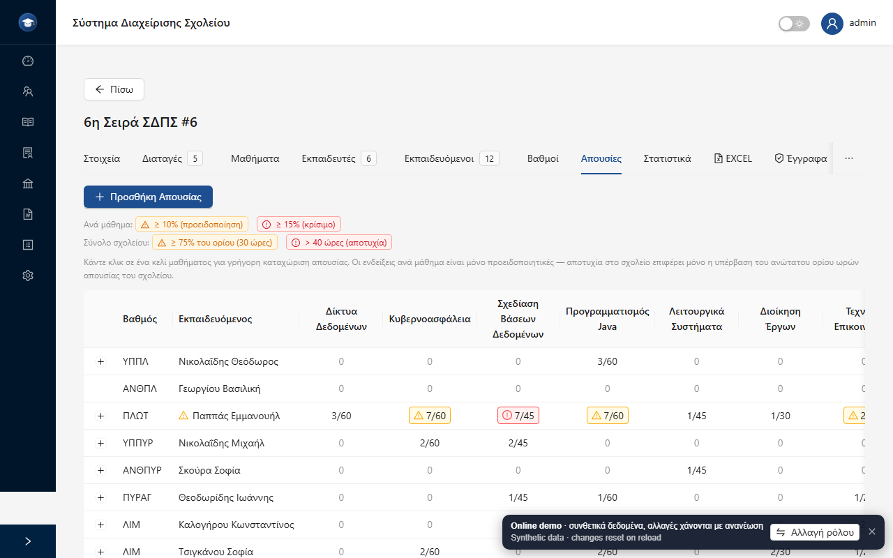

  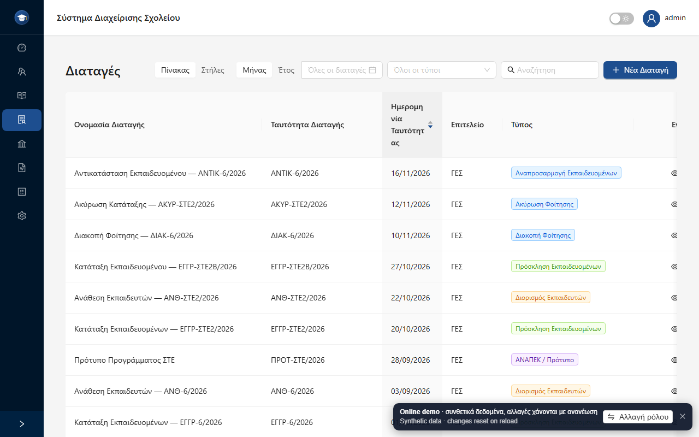
  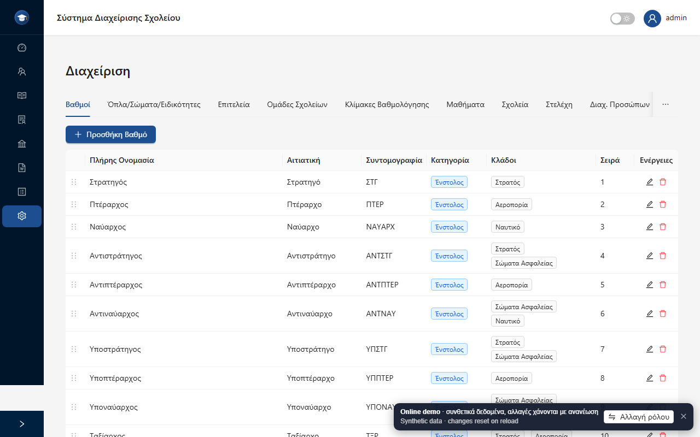

  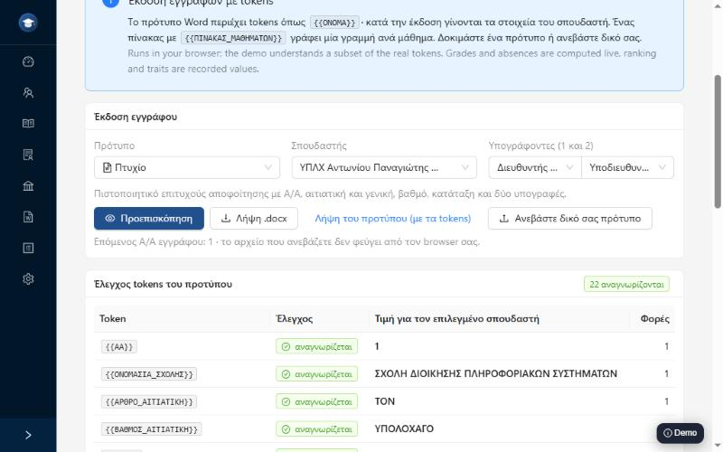
  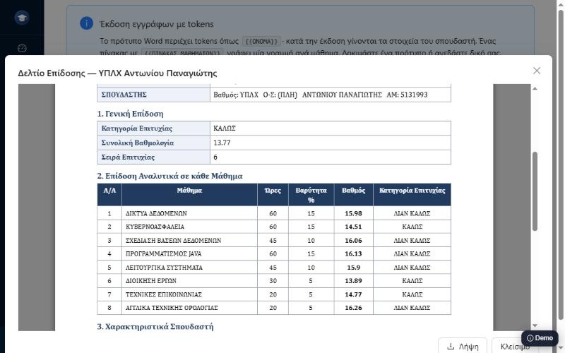

  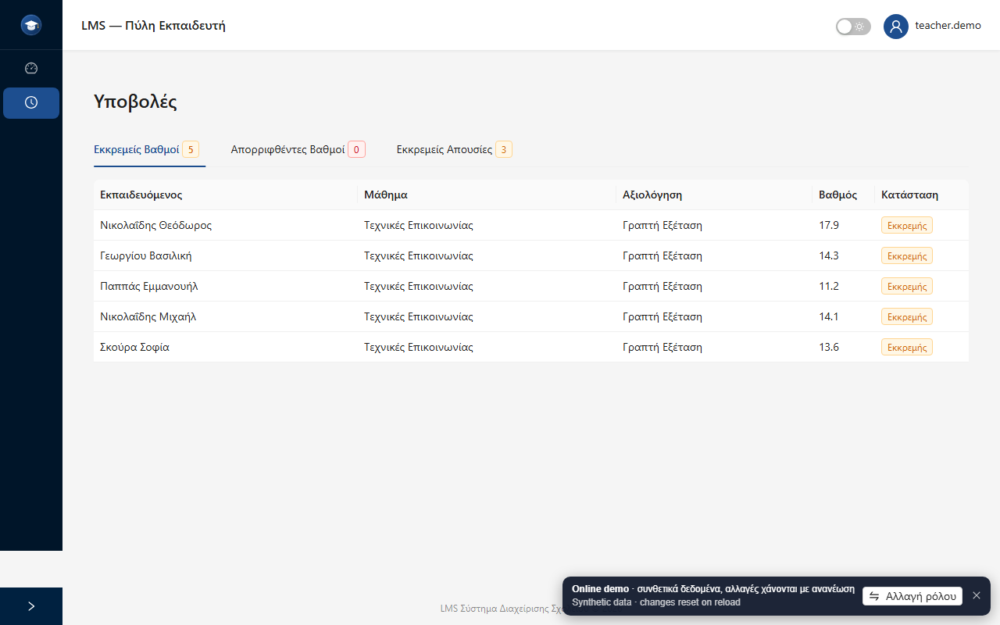
  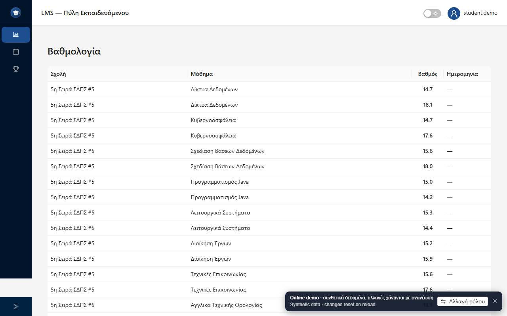

---

Created by **Evangelos Tempelopoulos**. © 2026, all rights reserved.
